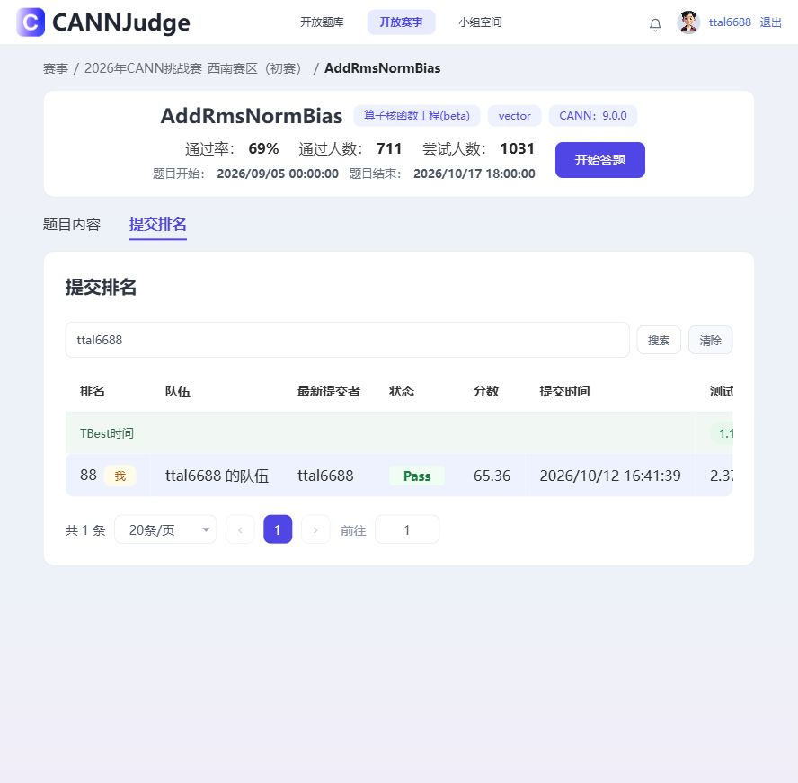

# CANN_HuaiWei

当前最佳完整官方记录：**E027_COMBO，65.36分，15/15 Pass**，[提交752881](https://cannjudge.cn/public/op_challenge_xinan_prelim/addrmsnormbias/submission/6acc9d43694b590c3cdc5c62)，2026-10-12 16:41:39，观察排名88。此前FACC/743109记录为64.98分；TBest参考随排行榜变化，不能把两次显示分数的差值全归因于代码。当前目标72分尚未达成。

- [当前交接文档](HANDOFF.md)：选中源码身份、15点耗时、优化路线和复现边界。
- [完整比赛工程](best_submission_752881.zip)、[当前内核](kernel.asc)、[选择记录](selection.json)、[全部官方结果](official_results.json)。
- [E028八阶段后续优化记录](experiments/E028_target72/报告.md)：候选源码、失败结果、指令仿真、msprof原始证据及64.52分正式提交。
- [72分优化入口](docs/优化目标72分_E028.md)、[下一轮实现假设](experiments/E028_target72/下一轮实现假设.md)、[增量同步哈希清单](experiments/E028_target72/sync_manifest.json)。
- [E027九阶段实验报告](experiments/E027_target70/报告.md)：全部正负结果、工具分析、候选源码和原始证据索引。
- [比赛实际收到的工程](experiments/E027_target70/COMBO/official_submission_752881.zip)：已下载核验，8个文件均与本轮选中工程逐字节一致。
- [历史E026交接](HANDOFF_E026.md)、[E026报告](实验报告_E026.md)、[FACC旧最佳工程](best_submission_743109.zip)、[完整E026实验包](E026_full_experiment.zip)继续保留。
- [文件哈希清单](MANIFEST.json)，本轮细项另见[E027清单](experiments/E027_target70/MANIFEST.json)。

COMBO采用FP32宽行四行批量、大工作集跨核循环行分配、FP16短行参数搬运重叠。每个守卫由dtype、D、rows及可用核数决定，fallback以完整源码为准。九阶段云机试验完成；负收益候选未合并。小形状继续研究归约关键路径和固定开销，大形状优先流水与搬运；BF16精度修复按用户要求暂缓。

云机为Ascend910B3、CANN9.0.0、40个向量核；本机Windows用于代码及证据归档。自建输入不是官方隐藏输入，云机局部收益不是官方分数。采用一次完整官方结果，避免拼接不同提交的最快点。

E028最新正式提交756788为64.52分、15/15 Pass，未替换历史最佳65.36分的主内核。短FP32 S256B和FP16参数调度P9LP保留研究；P9LP的第6/7点代理约+2.79%/+1.69%，仍需复测和正式评测。当前PR在原E027改动上仅追加E028及交接，不重新导入更早实验或另一仓库的整仓快照。

2026-10-13：阶段09的P9DB/P9MASK候选及保护/计时脚本已准备，尚未CANN编译或设备执行，详见[准备审查](experiments/E028_target72/phase09_preparation.json)。云机转发需恢复后才能测量；当前主内核和官方成绩不变。
