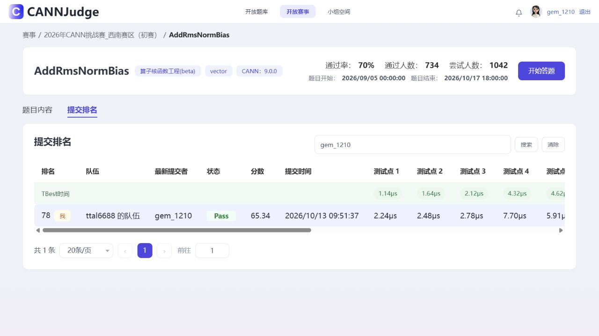

# CANN_HuaiWei

AddRmsNormBias 优化研究归档，更新于 2026-10-13。

<!-- E029 latest continuation -->
新增[E029继续优化记录](experiments/E029_target72_latest/报告.md)：正式775267为64.65分、15/15 Pass，未超过历史65.34分，根目录最佳保持。用户后续已恢复优化并将目标设为72分；下文“停止新增测试”是上一轮结束时的历史状态。赛事新增Host/Device与单Kernel规则已纳入源码审查。

**最高完整官方成绩：FRESLONG 65.34 分，15/15 Pass。** [提交 768708](https://cannjudge.cn/public/op_challenge_xinan_prelim/addrmsnormbias/submission/6acd8ea9e769892927ee263e)，当时观察排名78。根目录与 scripts/ 为这一次完整提交的八文件工程，未拼接各次最快测试点。

本轮更换方法并完成10次正式测试，全部15/15；最后 AXSMALL 64.02分。最高未超过70分，已按用户限定停止新增测试。网站排名当前显示最后提交的64.02分，65.34是历史最高观察成绩。TBest与计时会变化，不将0.36分的增幅全部归因于算法。

- [交接与方法取舍](HANDOFF.md)、[E027实验报告](实验报告_E027.md)。
- [最佳完整比赛工程](best_submission_768708.zip)、[kernel.asc](kernel.asc)、[选择依据](selection.json)。
- [本轮10次官方结果](official_results_E027.json)、[历史正式结果](official_results.json)。
- [E027完整源码、驱动与网页证据包](E027_full_experiment.zip)、[文件身份清单](MANIFEST.json)。
- 先前 E026、E024 归档保留；[上一阶段顶层交接](E026_previous_handoff.zip)也保留，另可查看 Git 历史。

本轮已经尝试树形/块归约、静态片上驻留、计算重排、FP16方差、Rsqrt修正、核波次和DMA/Axpy融合。FRESLONG 在自建FP32长行上降低设备耗时，但正式成绩没有同等幅度提升。云机结果与官方隐藏输入区分记录；后期SSH断开，后期云机完整原始日志尚未全部下载，详细边界见交接文档。

